# Cisco Meraki WLAN Snapshot

> **Disclaimer:** this is an independent, unofficial project. It is not made, endorsed or supported by Cisco or Meraki. It's an attempt to build a useful wireless report from the data the Meraki platform already generates and exposes through its public [Dashboard API](https://developer.cisco.com/meraki/api-v1/). Every figure is read from that API and then summarised by this tool, so numbers can differ from what Meraki Dashboard shows, and the explanations and suggested actions are this tool's interpretation, not Meraki guidance. Provided as is, with no warranty. Cisco and Meraki are trademarks of Cisco Systems, Inc.

> **Read-only.** The tool only sends GET (read) requests to the Meraki Dashboard API. It never sends POST, PUT, PATCH or DELETE requests and makes no changes whatsoever, so it can't change any setting, device or network. A **read-only admin API key** is all it needs, and is recommended.

A small app that runs on your own computer. Paste a Meraki API key, pick a wireless network, and it takes a **snapshot**: about 30 seconds of read-only API calls, saved as a data file and a report. Take one before an install and another after, or one a month, and open any report to compare it with another snapshot of the same network or a different one.

Meraki keeps detailed wireless history only for a short time (per-radio utilization for 14 days, most other history for 31 days). Saving snapshots as files means you can still compare against a point in time long after Meraki has deleted that data.

## What's in a report

The screenshots below come from a demo snapshot in which every name, serial number, MAC address, IP address and SSID has been replaced. Click any image to see it full size.

### Overview

The first screen. **Things to look at** lists the facts that need attention, most serious first, each with a button to its detail; healthy items are left out. **Key metrics** shows availability (APs online, uptime over the period) and five client-experience measures: successful connects, coverage, capacity, roaming and responsiveness, each with the share in a healthy range and the main reason it falls short. **Network configuration** covers RADIUS servers, AI-RRM, the regulatory domain (and whether 6 GHz is allowed), Air Marshal and SSIDs. **Observations** covers auth failures, upstream packet loss, clients per day and problematic clients.

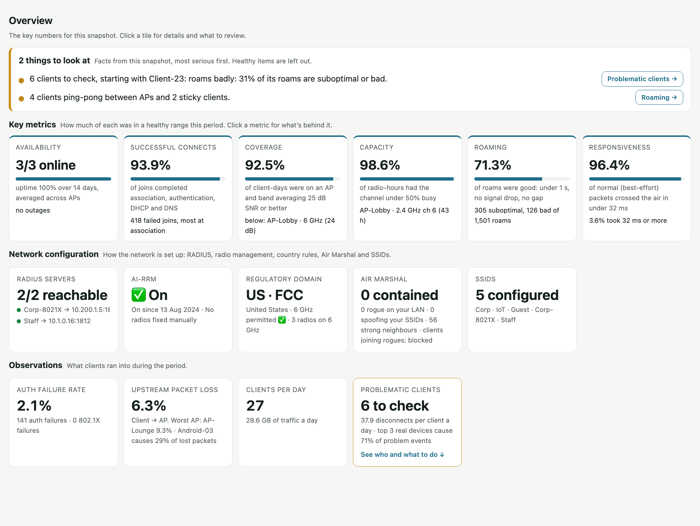

Click any metric or tile for what's behind it. **Availability** lists every AP with its IP, MAC, uptime, status, clients, model and firmware, plus firmware status, Meraki's own health alerts and any outages in the period:

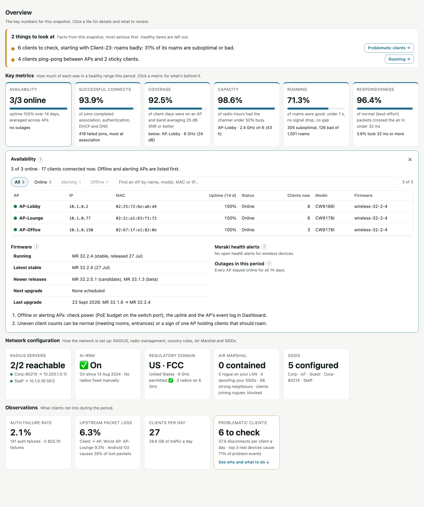

**SSIDs** lists every enabled SSID with its security, encryption, RADIUS servers, bands, the APs broadcasting it and the clients seen on it:

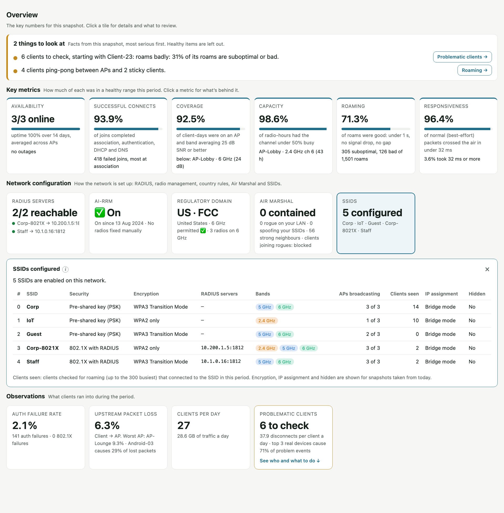

### Scorecard

Every metric in one table with a plain-language explanation and a daily trend line. In a comparison, each change is green (better), red (worse) or grey (within normal variation). Click a row to open a side panel with the clients, radios, APs or networks behind that number. Optional guidelines (rules of thumb, never used to colour comparisons) sit behind a button.

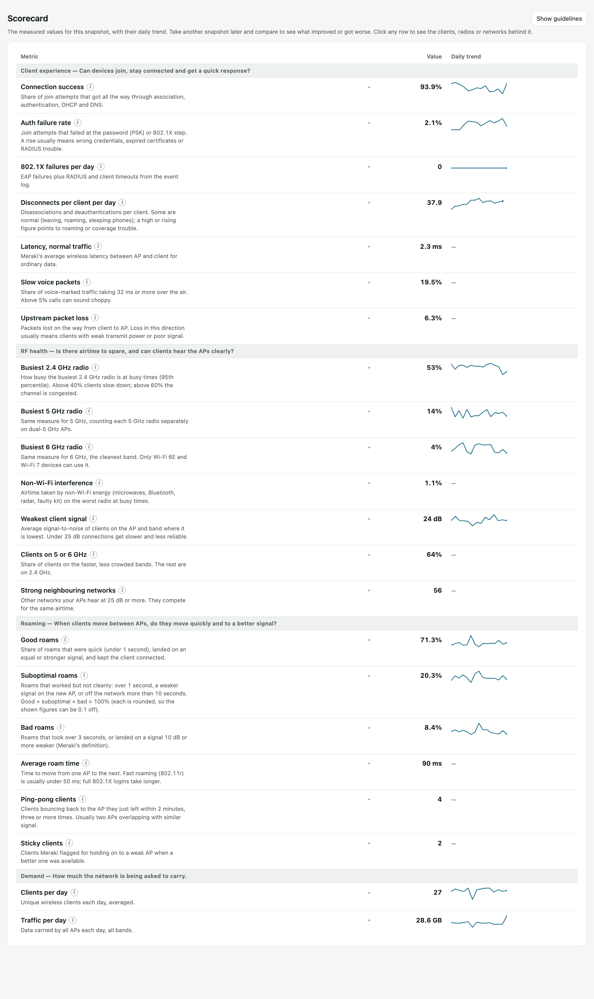

### Problematic clients

The clients behind most disconnects and 802.1X failures, the most likely cause for each and what to do about it, with a link to that client's roam timeline. Below: where joins fail (association, authentication, DHCP or DNS), which event types dominate, and which APs log the most events. Meraki's own test clients are recognised and set aside.

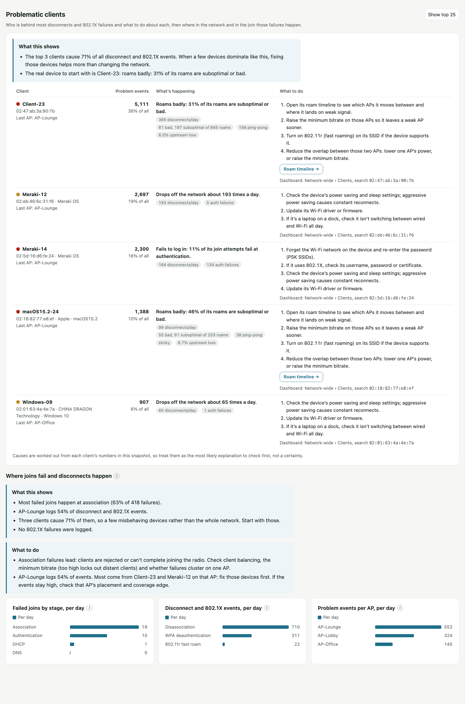

### Roaming

Roams rebuilt from each client's connection events and classed as good, suboptimal or bad (rules beside the timeline). A roam map shows how clients move between APs, a daily chart shows roam quality over time, and the clients struggling most are listed. Pick any client for a timeline of every roam and a log you can filter.

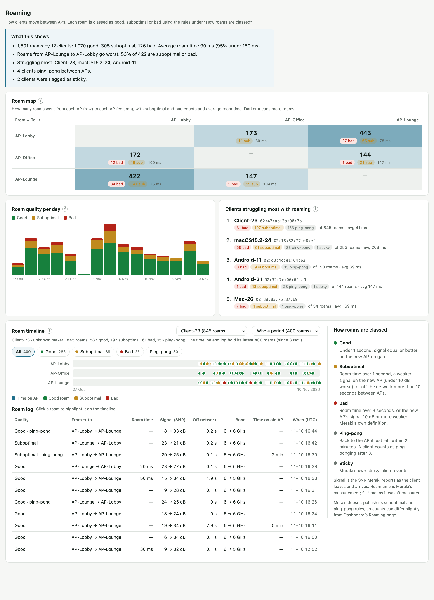

### Where clients connect

Which band and radio clients actually use. The band buttons show each band's share of connection attempts and its success rate; the SSID and radio drop-downs narrow everything below, including the list of clients and the radios they joined.

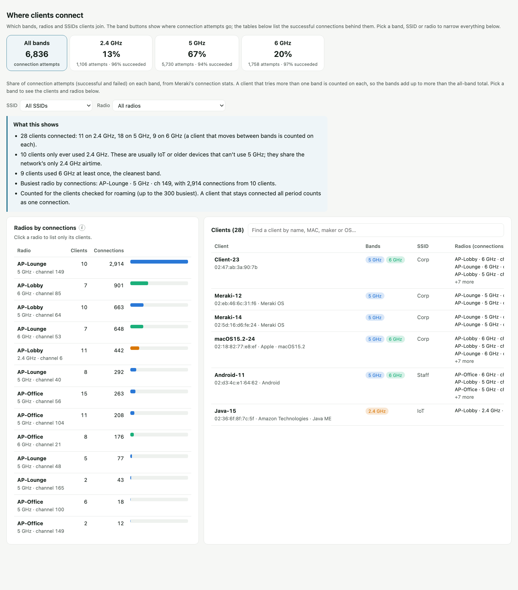

### By band

How 2.4, 5 and 6 GHz each perform side by side: client share, connection success, failures, latency, signal, busiest radio, packet loss and traffic.

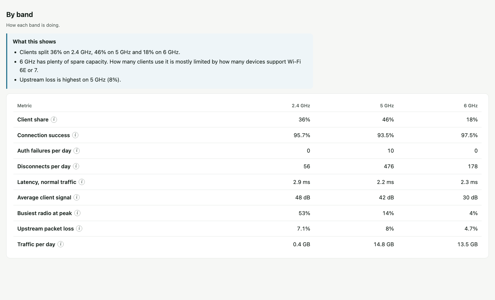

### Radio utilization

How busy every radio is from 10-minute samples (average, peak, maximum and non-Wi-Fi interference), how many clients use it, and a trend line on one shared scale so radios compare at a glance. Filter by band or AP; click a radio for its clients, signal, traffic, busiest hour and neighbouring networks on its channel.

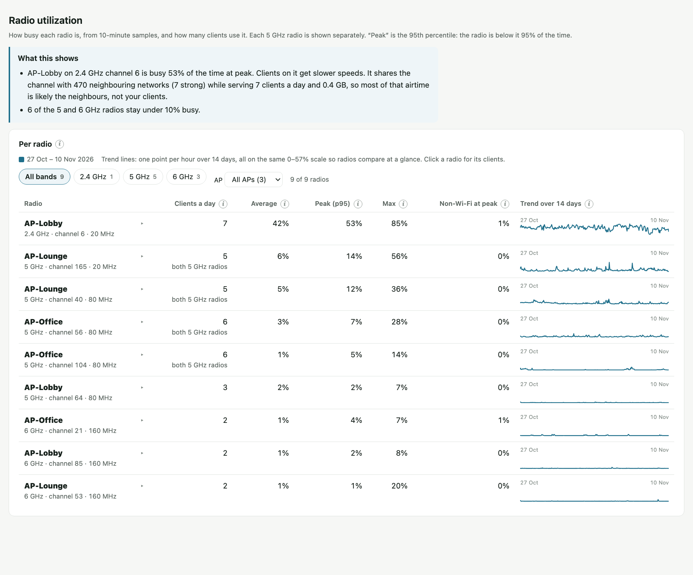

### RF configuration

The channel, width, power and SSIDs of every radio, and the RF profile in use. In a comparison, radios whose settings changed are highlighted.

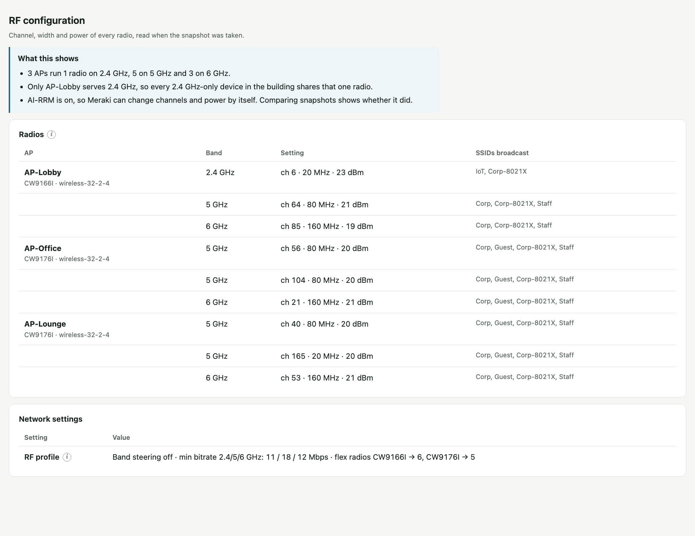

### Network path

How the APs connect to the rest of the network. A tree from LLDP and CDP shows every switch and AP with its IP and the port on each link. Pick an AP and an SSID to see the path drawn as a topology: client, AP, each switch with its port numbers, the MX, then the site-to-site VPN and the RADIUS server for an 802.1X login, or the internet for a client's own traffic. Each device and link shows a tick when it's online or reachable and a cross when it isn't.

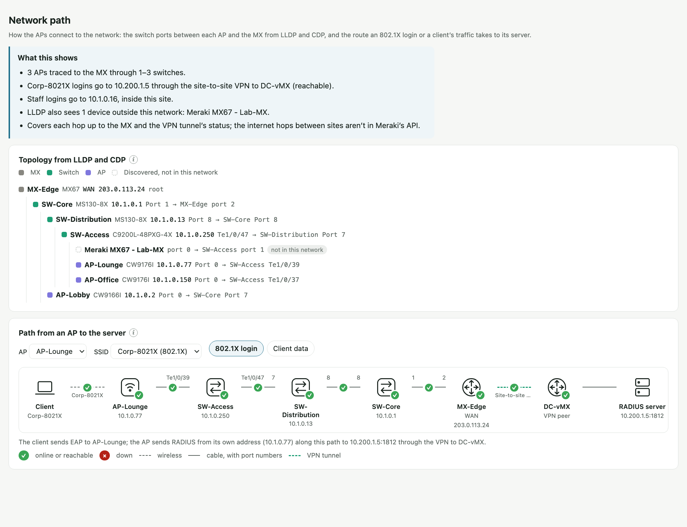

### Also in every report

- **Compare:** load another snapshot of the same network (earlier or later) or of another network; every change is coloured.
- **Export** as HTML (keeps working offline and can be loaded back to compare), data (.json) or PDF.
- **Light and dark mode**, section links that stay at the top, an **(i)** beside every figure naming the API endpoint and how far back it reads, and a full list of every endpoint used under **Sources and method**.

## Requirements

- **Python 3.8 or newer.** If it's missing, the launcher offers to install it: on Windows through Windows Package Manager (just for your account, no admin rights needed), and on a Mac through Apple's Command Line Tools installer. You can also get it from <https://www.python.org/downloads/>. On Windows, tick **"Add python.exe to PATH"** during install. No other packages are needed.
- **A Meraki Dashboard API key.** A key for a read-only admin is enough, because the tool never makes changes. See [how to create an API key](https://developer.cisco.com/meraki/api-v1/authorization/).

## Start it

1. Unzip the folder anywhere.
2. Double-click the launcher for your system:
   - **Mac:** `Start WLAN Snapshot (Mac).command`. The first time, macOS may block it because it was downloaded. Right-click it, choose **Open**, then **Open** again.
   - **Windows:** `Start WLAN Snapshot (Windows).bat`.
3. Your browser opens the app. Paste your API key and click **Connect**.
4. Pick a wireless network, give the snapshot a label (for example `pre-install`) and click **Generate report**.

A snapshot takes about 30 seconds for a small network and longer for a large one; the page shows progress. The report opens when it's done. Keep the small terminal window open while you use the app. Closing it stops the app.

From a terminal you can also run `python3 server.py --open`, adding `--port 9000` if you want a specific port.

## About your API key

- It's stored only in your browser on your computer. Untick "Remember on this computer" to keep it only until the browser tab closes.
- It's sent only to this app running locally, which passes it to `api.meraki.com` and nowhere else.
- It's never written into a snapshot or a report.

## Snapshots and reports

Each snapshot saves two files in the `snapshots` folder:

- `Network-label-YYYYMMDD-HHMM.json`: the data. Keep it; it's the only record once Meraki deletes the history.
- `Network-label-YYYYMMDD-HHMM.html`: the report for that snapshot.

**How a report reads.** Most important first, detail one click away:

1. **Things to look at**: the facts that need someone's attention, most serious first: Meraki health alerts, APs not online or with outages in the period, firmware behind or mixed, RADIUS timeouts, rogue or spoofed networks, AI-RRM off or radios fixed manually, clients to check, ping-pong and sticky clients, and, in a comparison, metrics that got worse. Healthy items are left out. Each has a button to its detail.
2. **Key metrics**: availability (APs online now, with uptime over the period; click for every AP's IP, MAC and uptime), then five measures of client experience, each the share of joins, client time, radio time or roams in a healthy range (see below). Click one for what's behind it.
3. **Network configuration**: RADIUS servers, AI-RRM, regulatory domain, Air Marshal and SSIDs. The SSIDs tile lists every enabled SSID; click it for each one's security, encryption, RADIUS servers, bands, APs broadcasting it, clients seen, IP assignment and whether it's hidden.
4. **Observations**: what clients ran into: auth failure rate, upstream packet loss, clients per day and problematic clients. Click any tile for its review guide.
5. **Scorecard**: every metric with its daily trend. Click a row for the clients, radios or networks behind it.
6. Then a client's experience in order: **Problematic clients** (who has problems and what to do, then where joins fail and which APs log the events), **Roaming**, **Where clients connect** and **By band**.
7. Then the RF and wired network underneath: **Radio utilization**, **RF configuration** and **Network path**, and finally **Sources and method**.

A bar of section links stays at the top of the page as you scroll, with the section you're reading highlighted. Sections fade in the first time they scroll into view, with numbers counting up, bars growing and trend lines drawing in; this is off when your system asks for reduced motion, and never in print or PDF.

**The period** is how much history a snapshot captures, counting back from when you click Generate report. The default and maximum is 14 days, because Meraki keeps per-radio detail for only 14 days. Use the same period every time so snapshots compare fairly. AP status and radio settings are read at the moment of capture.

**Comparing:** open a report through the app and pick another snapshot of the same network under **Compare with**, or use **Import snapshot…** to pick a `.json` from anywhere. A single snapshot shows values with no judgement; a comparison colours each change **green** (better), **red** (worse) or **grey** (no change beyond normal day-to-day variation). Snapshots can be any distance apart, today and a year from now. The report warns you if two periods overlap or are different lengths.

**Comparing with another network:** the **Compare with** list also shows snapshots of your other wireless networks, under **Other networks**. The report then puts the two networks side by side: columns are named after each network, green means this network does better and red means it does worse. AP-by-AP sections (radio settings, per-radio utilization) show this network only, because the APs are different. Networks differ in size, layout and use, so treat differences as prompts to look rather than verdicts. Use snapshots of the same period length.

**Exporting and keeping snapshots:** every report has **Export**:

- **HTML:** the report as one self-contained file. It opens on its own in any browser, and it can be loaded into a later report to compare, so it's a safe way to keep a snapshot. If a comparison is showing, the file holds both snapshots.
- **Data:** just the snapshot's data as a small `.json`, also loadable later.
- **PDF:** opens your browser's print dialog with a print layout; choose **Save as PDF**. PDFs are for reading and can't be loaded back.

**Import snapshot…** in any report accepts a report (`.html`) or data file (`.json`) saved by this app, from anywhere on your computer. You don't need to export anything to compare on the same computer: every snapshot is already saved in the `snapshots` folder and listed under **Compare with**. Export when you want a copy somewhere else, for example a project folder, a shared drive or an email.

## Meraki API endpoints used

Every figure in a report comes from these calls. The same list is shown in the app (**What this app reads from Meraki**) and at the bottom of every report (**Sources and method**), and `python3 wlan_snapshot.py endpoints` prints it.

| Area | Endpoint | What it reads | Shown in | How far back | Calls per snapshot |
|---|---|---|---|---|---|
| Finding your networks | `GET /organizations` | Lists the organizations your API key can see. | Network picker in the app | Current | 1 |
| Finding your networks | `GET /organizations/{organizationId}/networks` | Lists each organization's networks; the app keeps the ones with wireless. | Network picker in the app | Current | 1 per organization |
| Access points | `GET /organizations/{organizationId}/devices` | The network's access points: name, model, serial, firmware. | Access points tile, RF configuration | Current | 1 |
| Access points | `GET /organizations/{organizationId}/devices/statuses` | Online, alerting or offline; last time each AP reported; LAN IP. | Access points tile and list | Current | 1 |
| Access points | `GET /organizations/{organizationId}/devices/availabilities/changeHistory` | Every time an AP went offline, alerting or back online during the period. | Access points tile: uptime and outages | Period of the snapshot | 1+ |
| Access points | `GET /organizations/{organizationId}/assurance/alerts` | Meraki's own health alerts that are open now; the tool keeps those for wireless devices. | Things to look at, Access points tile | Open alerts at capture time | 1+ |
| Access points | `GET /networks/{networkId}/firmwareUpgrades` | The MR firmware running, newer releases available, and any scheduled or last upgrade. | Access points tile: firmware | Current | 1 |
| Access points | `GET /organizations/{organizationId}/wireless/clients/overview/byDevice` | Clients connected to each AP right now. | Access points tile and list | Current | 1 |
| RF configuration | `GET /organizations/{organizationId}/wireless/ssids/statuses/byDevice` | Every AP's radios in one call: band, channel, channel width, transmit power, radio index and the SSIDs each broadcasts. | RF configuration, radio utilization (which radio is which band), regulatory domain | Current | 1 (falls back to 1 per AP) |
| RF configuration | `GET /organizations/{organizationId}/wireless/rfProfiles/assignments/byDevice` | Which RF profile each AP uses, in one call. | RF configuration | Current | 1 |
| RF configuration | `GET /networks/{networkId}/wireless/rfProfiles` | Band steering, minimum bitrates, channel widths and flex-radio settings. | RF configuration | Current | 1 |
| RF configuration | `GET /networks/{networkId}/wireless/settings` | The network's regulatory domain: country, domain name (for example FCC) and whether Meraki permits 6 GHz there. It follows the country set for the network. | Regulatory domain tile | Current | 1 |
| RF configuration | `GET /organizations/{organizationId}/wireless/radio/rrm/byNetwork` | AutoRF settings: whether AI-RRM is on and when it was enabled, FRA, busy-hour behaviour, channel avoidance. | AI-RRM tile, RF configuration | Current | 1 |
| RF configuration | `GET /organizations/{organizationId}/wireless/radio/overrides/byDevice` | Radios with a manually fixed channel, power or channel width. These are outside AI-RRM's control even when it's on. | AI-RRM tile | Current | 1+ (pages of 100) |
| RF configuration | `GET /networks/{networkId}/wireless/airMarshal` | Other networks your APs hear, with signal strength. | Air Marshal tile, RF spectrum, Strong neighbouring networks | 31 days (last 7 days used) | 1 |
| RF configuration | `GET /organizations/{organizationId}/wireless/airMarshal/settings/byNetwork` | Air Marshal default policy (block or allow clients joining rogue SSIDs) and the scheduled scan setting. | Air Marshal tile | Current | 1 |
| RF configuration | `GET /organizations/{organizationId}/wireless/airMarshal/rules` | Air Marshal allow, block and alert rules that apply to this network. | Air Marshal tile | Current | 1 |
| Network path | `GET /networks/{networkId}/topology/linkLayer` | LLDP and CDP neighbours: which switch port each AP and switch plugs into, up to the MX. | Network path: topology and AP-to-server path | Current | 1 |
| Network path | `GET /networks/{networkId}/appliance/vlans` | The MX's VLANs: name, subnet and gateway. | Network path: VLANs | Current | 1 |
| Network path | `GET /organizations/{organizationId}/switch/ports/bySwitch` | Each switch port's name, mode (access or trunk), native VLAN and allowed VLANs. | Network path: port settings on every hop | Current | 1+ (pages of 50 switches) |
| Network path | `GET /organizations/{organizationId}/appliance/vpn/statuses` | Site-to-site VPN: this network's peers, whether each is reachable, and the subnets each advertises. | Network path: how each RADIUS server is reached | Current | 1+ |
| Network path | `GET /organizations/{organizationId}/appliance/uplink/statuses` | The MX's internet uplinks: status, IP, public IP and gateway. | Network path: WAN | Current | 1 |
| RF configuration | `GET /networks/{networkId}/wireless/ssids` | Enabled SSIDs, their security mode and RADIUS servers. | RADIUS servers tile | Current | 1 |
| Radio utilization | `GET /networks/{networkId}/networkHealth/channelUtilization` | How busy every radio is, in 10-minute samples, split into 802.11 (Wi-Fi) airtime and non-Wi-Fi interference. Each 5 GHz radio on dual-5 GHz APs separately. | Busiest radio tile, radio utilization, RF spectrum, scorecard | 14 days (Meraki refuses older 10-minute data) | 2 (7-day pages) |
| Clients and traffic | `GET /networks/{networkId}/wireless/clientCountHistory` | Clients per day, for the whole network, each band, and each AP and band. | Clients per day, band share, clients per radio | 31 days | 4 + N×B |
| Clients and traffic | `GET /networks/{networkId}/wireless/usageHistory` | Traffic per day for each AP and band. | Traffic per day, by band | 31 days | N × B |
| Clients and traffic | `GET /networks/{networkId}/wireless/signalQualityHistory` | Client signal-to-noise (SNR) per day for each AP and band. | Weakest client signal, by band | 31 days | N × B |
| Clients and traffic | `GET /networks/{networkId}/clients` | Every client: name, MAC, maker, OS, SSID, last AP, data used, and the client ID needed for roaming. | Client lists in the detail panels | 31 days | 1+ (pages of 1,000) |
| Connection quality | `GET /networks/{networkId}/wireless/connectionStats` | Successful joins and failures at association, authentication, DHCP and DNS; whole network, each band, and each day. | Connection success, auth failure rate, failed joins by stage | 180 days documented, about 65 days in practice; 7 days per call | 8 + D |
| Connection quality | `GET /networks/{networkId}/wireless/clients/connectionStats` | The same join results for each client. | Connection success and auth detail panels | 180 days; 7 days per call | 2 |
| Connection quality | `GET /networks/{networkId}/wireless/latencyStats` | Wireless latency per traffic class (voice, video, best effort, background), whole network and each band. | Latency, slow voice packets | 180 days; 7 days per call | 8 |
| Connection quality | `GET /networks/{networkId}/wireless/clients/latencyStats` | The same latency figures for each client. | Latency and voice detail panels | 180 days; 7 days per call | 2 |
| Connection quality | `GET /organizations/{organizationId}/wireless/devices/packetLoss/byDevice` | Upstream and downstream packet loss per AP, whole network and each band. | Upstream packet loss, by band | 90 days | 4 |
| Connection quality | `GET /organizations/{organizationId}/wireless/devices/packetLoss/byClient` | Packet loss per client. | Packet loss detail panel | 90 days | 1 |
| Client events | `GET /networks/{networkId}/events` | Wireless event log (productType=wireless): disassociations, WPA and 802.1X deauthentications, 802.1X failures and RADIUS timeouts, 802.1X successes, fast roams. | Disconnects, 802.1X failures, RADIUS reachability, client issues | 60+ days in practice | 1 per 2-day slice, plus 1 per extra 1,000 events (slices fetched in parallel) |
| Roaming | `GET /networks/{networkId}/wireless/clients/{clientId}/connectivityEvents` | Each client's roam, connection and sticky events: the AP it left and joined, roam time, signal before and after. | Roaming tile, scorecard rows and section | 31 days | C (up to 300 busiest clients) |

N = access points, B = bands per AP, C = wireless clients, D = days in the period. A 14-day snapshot of a 3-AP network makes about 145 calls and takes about 25 seconds; a busier 3-AP site with a chatty client took about 30 seconds for 196 calls. On large sites most calls go to roaming (one per client, capped at the 300 busiest) and to the per-AP, per-band history (three calls per AP and band).

**Speed and Meraki's rate limit.** Meraki allows 10 requests a second per organization, shared by every tool using it. This tool sends at most 8 a second, through one shared rate limiter, with up to 8 requests in flight so it isn't waiting on one slow reply at a time. If Meraki answers 429 (too many requests), every request pauses for the time Meraki asks (Retry-After) before carrying on. To keep the call count down it uses org-wide calls where Meraki has them: one call for every AP's radios and SSIDs, and one for every AP's RF profile, instead of two calls per AP. Long sequential page chains are split by time: the event log is read in one-day slices, and a very busy client's connection events in two-day slices, all fetched in parallel. To be gentler on an organization that other tools also use, lower `MAX_RPS` in `wlan_snapshot.py`.

Wireless event types read from the event log: `disassociation`, `wpa_deauth`, `8021x_deauth`, `8021x_eap_failure`, `8021x_radius_timeout`, `8021x_client_timeout`, `8021x_eap_success`, `aps_association_reject`, `11r_fast_roam`.

### How each metric is calculated

| Metric | Calculation | From |
|---|---|---|
| Access points online | APs whose status is `online`, out of all APs in the network | `devices/statuses` |
| AP uptime and outages | Each AP's status changes during the period (offline, alerting, back online); uptime is the share of the period it was online | `devices/availabilities/changeHistory` |
| Firmware | The MR version running and its release type, the latest stable release, newer candidate or beta releases, scheduled and last upgrade, and APs on different versions. Flagged when a newer stable release exists, when the network runs a candidate or beta, or when APs differ | `firmwareUpgrades`, `devices` |
| Meraki health alerts | Alerts open at capture time in Dashboard's Assurance view, kept when they concern wireless devices. Each one is listed under Things to look at | `assurance/alerts` |
| AI-RRM | On or off for the network, from `ai.enabled`, with the date it was enabled. Radios with a fixed channel, power or width are listed, because AutoRF and AI-RRM can't manage them | `wireless/radio/rrm/byNetwork`, `wireless/radio/overrides/byDevice` |
| Regulatory domain | The network's country, regulatory domain (for example FCC) and whether Meraki permits 6 GHz there, from `regulatoryDomain`. Flagged when no country is set (Meraki's default domain), when 6 GHz radios are on although 6 GHz isn't permitted, or when 6 GHz is permitted but unused. Click the tile to compare each AP's address in Dashboard with the country | `wireless/settings`, `devices/statuses` |
| RADIUS servers reachable | A server counts as reachable when at least one AP logged a successful 802.1X login through it; APs with RADIUS timeouts are listed as warnings | `wireless/ssids`, `events` |
| Connection success | Successful joins ÷ (successful + failed at association, authentication, DHCP or DNS) | `wireless/connectionStats` |
| Auth failure rate | Joins failed at authentication ÷ all join attempts | `wireless/connectionStats` |
| 802.1X failures per day | EAP failures + RADIUS timeouts + client timeouts, ÷ days | `events` |
| Disconnects per client per day | Disassociations + WPA and 802.1X deauthentications, ÷ (average daily clients × days) | `events`, `wireless/clientCountHistory` |
| Latency, normal traffic | Meraki's average best-effort latency, weighted by samples across the 7-day pages | `wireless/latencyStats` |
| Slow voice packets | Voice samples in Meraki's 32 ms-or-slower buckets ÷ all voice samples | `wireless/latencyStats` |
| Upstream packet loss | Packets lost ÷ packets sent, client to AP, all APs | `wireless/devices/packetLoss/byDevice` |
| Busiest 2.4 / 5 / 6 GHz radio | The highest 95th percentile of 10-minute utilization among that band's radios | `networkHealth/channelUtilization` |
| 802.11 vs non-Wi-Fi (RF spectrum, not shown yet) | Collected in every snapshot; the RF spectrum section is switched off for now (`SHOW_SPECTRUM` in `report_template.html`). Meraki splits every 10-minute utilization sample into `wifi` (802.11 frames from any network on the channel: your clients and APs, beacons, retries and neighbours) and `non_wifi` (energy that isn't Wi-Fi: microwaves, Bluetooth, cordless phones, video senders, radar). Average and 95th percentile of each, per radio and per day. The channel map draws each radio across its full channel width; radios whose channels overlap share the block side by side. Neighbouring networks per channel come from Air Marshal and are drawn 20 MHz wide on their primary channel. It's a channel map from 10-minute averages, not a live spectrum analyser: Meraki's live FFT and waterfall (Dashboard: Wireless › RF spectrum) aren't in the API | `networkHealth/channelUtilization`, `wireless/airMarshal` |
| Band buttons (Where clients connect) | Each band's share of connection attempts (successes + failures) from `wireless/connectionStats` per band. A client that tries more than one band counts on each, so bands add up to more than the all-band total. With one SSID picked, the share of that SSID's successful connections instead | `wireless/connectionStats`, `clients/{clientId}/connectivityEvents` |
| Clients a day per radio | Unique clients per day on that AP and band, averaged over the period. Meraki counts per AP and band, so an AP with two 5 GHz radios shows one figure for both. Click a radio for the clients that connected to it (matched by AP, band and channel from connection events) and its client signal, traffic, busiest hour and neighbours on its channel | `wireless/clientCountHistory`, `clients/{clientId}/connectivityEvents` |
| Non-Wi-Fi interference | The highest 95th percentile of non-Wi-Fi utilization on any radio | `networkHealth/channelUtilization` |
| Weakest client signal | The lowest average client SNR of any AP and band | `wireless/signalQualityHistory` |
| Clients on 5 or 6 GHz | 5 GHz + 6 GHz share of average daily clients per band | `wireless/clientCountHistory` |
| Strong neighbouring networks | Other networks' BSSIDs heard by one of your APs at 25 dB or more, last 7 days | `wireless/airMarshal` |
| Air Marshal | Contained BSSIDs (Meraki's `contained` flag); rogue = an SSID Meraki classes as rogue or saw on your wired LAN; spoofing = a neighbour broadcasting one of your SSID names; open = no encryption or WEP. Also the default policy for clients joining rogue SSIDs, any Air Marshal rules, and which of your radios share a channel (across its full width) with neighbours heard by that AP. Last 7 days | `wireless/airMarshal`, `wireless/airMarshal/settings/byNetwork`, `wireless/airMarshal/rules` |
| Good roams / bad roams | Share of roams in each class (see below) | `clients/{clientId}/connectivityEvents` |
| Average roam time | Mean of Meraki's measured roam times; roams Meraki didn't time are left out | `clients/{clientId}/connectivityEvents` |
| Ping-pong / sticky clients | See below | `clients/{clientId}/connectivityEvents` |
| Clients per day | Average of daily unique wireless clients | `wireless/clientCountHistory` |
| Traffic per day | Each AP and band's average daily throughput, converted to GB per day and summed | `wireless/usageHistory` |

**RADIUS reachability is worked out, not measured.** Meraki's API has no read-only RADIUS health check, so the report counts, per AP and per 802.1X SSID, successful 802.1X logins (proof that AP reached the server) and RADIUS timeouts (it didn't). An AP with no 802.1X logins in the period shows grey: unknown, not down.

### Key metrics

Each key metric is a percentage: how much of the period, the joins or the roams fell in a healthy range. One snapshot shows the values only; a comparison colours the change green, red or grey. The healthy ranges are common rules of thumb, not Meraki thresholds, and are set at the top of `report_template.html` (`SL_SNR`, `SL_BUSY`, `SL_LAT`).

| Metric | Measured as | From |
|---|---|---|
| Availability | APs online when the snapshot was taken (the headline), with uptime over the period averaged across APs (the bar) | `devices/statuses`, `devices/availabilities/changeHistory` |
| Successful connects | Joins that completed association, authentication, DHCP and DNS, out of all join attempts | `wireless/connectionStats` |
| Coverage | Client-days on an AP and band whose average client SNR is 25 dB or better, weighted by each AP and band's clients a day | `wireless/signalQualityHistory`, `wireless/clientCountHistory` |
| Capacity | Radio-hours with the channel under 50% busy, across every radio | `networkHealth/channelUtilization` |
| Roaming | Good roams (under 1 s, no signal drop, no gap) out of all roams | `clients/{clientId}/connectivityEvents` |
| Responsiveness | Normal (best-effort) packets that crossed the air in under 32 ms | `wireless/latencyStats` |

These are built from Meraki's per-AP, per-radio and network averages, so they follow the same idea as other vendors' experience metrics but aren't directly comparable with tools that measure each client minute by minute.

### Network path

How the APs connect to the rest of the network, from read-only calls: LLDP and CDP neighbours (`topology/linkLayer`), switch port names, the MX's VLANs (to tell whether a server is inside the site), the site-to-site VPN and the MX's internet uplinks.

- **Topology**: every device LLDP or CDP sees, as a tree from the MX down, with its IP (switches and APs: LAN IP; MX: WAN IP) and the port each one uses to reach the device above it. Devices outside the network (for example another MX plugged into a switch) are marked.
- **Path from an AP to the server**: pick an AP and an SSID and the path is drawn as a topology, left to right: client, AP, each switch, the MX, then the VPN peer and the server (or the internet). Wireless links are dashed, cables solid with the port number at each end, the VPN tunnel dashed green; each device and link carries a tick when it's online or reachable and a cross when it isn't. *802.1X login* follows the RADIUS request, which the AP sends from its own address; *Client data* follows the client's traffic to the internet.
- Flagged: a RADIUS server reached through a VPN peer that isn't reachable, APs that connect through another AP rather than a switch, and devices outside the network.

Limits: Meraki's API covers each hop up to the MX and the VPN tunnel's status, not the internet hops between sites. A server's own switch port isn't in LLDP, so a local server's last hop isn't shown. Switches from other vendors appear by name and port only.

### How roams are classed

Meraki's API has no roaming-analytics endpoint, so roams are rebuilt from each client's connectivity events: a `roam` event on the AP it left (signal there, time spent there), then a `connection` event with `reassoc` on the new AP (signal on arrival, roam time).

- **Bad:** roam time over 3 seconds, or the new AP's signal is 10 dB or more weaker (Meraki's definition).
- **Suboptimal:** roam time over 1 second, a weaker signal on the new AP (under 10 dB worse), or the client was off the network for more than 10 seconds between APs.
- **Good:** everything else.
- **Ping-pong:** back to the AP the client just left within 2 minutes. A client counts as ping-ponging after 3 of these.
- **Sticky:** Meraki's own sticky-client events.

Meraki doesn't publish its rules for suboptimal and ping-pong, so counts can differ slightly from the Roaming page in Dashboard. Change the thresholds at the top of `wlan_snapshot.py`.

## Guidelines

Guidelines are hidden by default. Click **Show guidelines** above the scorecard to add a column with each one. Values outside a guideline get a neutral "Outside guideline" note, not a red mark, and guidelines are never used to colour a comparison. They're rules of thumb for enterprise Wi-Fi, not Meraki thresholds or pass/fail tests; each one's (i) explains its basis and when it can mislead.

| Metric | Guideline | Can mislead when |
|---|---|---|
| Connection success | ≥ 95% | A few devices retrying a wrong password pull it down |
| Auth failure rate | < 1% | One device with an old saved password fails all day |
| 802.1X failures per day | < 1 | Test accounts or one laptop with an expired certificate |
| Disconnects per client per day | < 10 (rough estimate) | Phones disassociate when they sleep and when they roam |
| Latency, normal traffic | < 10 ms | Meraki's average looks better than its own histogram |
| Slow voice packets | < 5% | No real voice devices, so a few mismarked packets dominate |
| Upstream packet loss | < 1% | A few clients at the edge of coverage cause most of it |
| Busiest radio per band | < 40% | In dense buildings, neighbours fill 2.4 GHz whatever you do |
| Non-Wi-Fi interference | < 10% | Brief spikes from microwaves or radar are normal |
| Weakest client signal | ≥ 25 dB | A few distant clients drag the weakest AP down |
| Clients on 5 or 6 GHz | ≥ 60% (rough estimate) | IoT devices are often 2.4 GHz only |
| Good roams | ≥ 90% (rough estimate) | A couple of devices at the edge of coverage |
| Bad roams | < 2% | Clients walking out of the building |
| Average roam time | < 150 ms | One slow 802.1X roam among few roams |
| Ping-pong / sticky clients | 0 | Some devices are sticky whatever the network does |

Edit them in `report_template.html` (`tgt` in the `M` list and the `GUIDE` notes).

## Limits to know

- **Per-radio utilization only goes back 14 days.** Meraki refuses 10-minute data older than 14 days, so a snapshot can't cover an older period.
- **A snapshot can't be taken for the past.** To have a "before", take it before the change.
- **Radio settings are read when the snapshot runs.** They describe the network at that moment, not the whole period.
- **Radio-to-band mapping:** wifi0, wifi1 and wifi2 are matched to bands by the order Meraki lists each radio's BSSIDs. Verified on CW9166I and CW9176I.
- **Latency:** Meraki's reported average can look much better than its own histogram, which is why the slow-voice figure comes from the histogram.
- **Roaming on large sites** covers the 300 busiest clients; the report says when others were skipped.

## Privacy

Snapshots and reports include each wireless client's name, MAC address, maker, OS and per-client statistics, plus AP IP addresses. Treat them as customer data. They stay on your computer in the `snapshots` folder; nothing is sent anywhere except the API calls to Meraki.

## Troubleshooting

| Problem | Fix |
|---|---|
| "Meraki rejected that API key" | Check the key in Meraki Dashboard (My Profile → API access) and that API access is enabled for the organization. |
| A network you expect isn't listed | Only networks with wireless are listed, and only in organizations where API access is enabled. |
| Windows: nothing happens, or the window flashes and closes | Make sure you extracted the zip (right-click → **Extract All…**) and are running the launcher from the extracted folder, not from inside the zip. |
| Windows: Python was just installed but the app doesn't start | Close the launcher window and double-click it again. |
| Windows: "Windows protected your PC" | Click **More info** → **Run anyway**. |
| `CERTIFICATE_VERIFY_FAILED` on Mac | Open your Python folder in Applications and run **Install Certificates.command**. |
| A snapshot is slow | Large sites make one roaming call per client (up to 300). Leave the window open; progress shows on the page. |
| A report looks out of date | Hard refresh with ⌘⇧R or Ctrl+Shift+R. |

## Command line

The same tool works without the app:

```bash
export MERAKI_API_KEY=your_key_here
python3 wlan_snapshot.py list
python3 wlan_snapshot.py snapshot --network "Head Office" --label pre-install
python3 wlan_snapshot.py report snapshots/Head-Office-*.json
python3 wlan_snapshot.py endpoints
```

`--days` sets the period (default and maximum for per-radio detail: 14). `report` builds one report holding several snapshots.

## Files

- `server.py`: the local app. Serves the pages and runs snapshots.
- `app.html`: the start page (API key, network, Generate report, saved snapshots).
- `wlan_snapshot.py`: takes snapshots, works out the metrics, builds reports. The `ENDPOINTS` list at the top documents every API call.
- `report_template.html`: the report.
- `Start WLAN Snapshot (Mac).command`, `Start WLAN Snapshot (Windows).bat`: the launchers.
- `docs/screenshots/`: the images in this README, taken from an anonymised demo snapshot (no real names, serials, MACs, IPs or SSIDs). The report's screenshot mode (`report.html#shot=<section id>`) shows one section on its own in light mode, which is how they're made.
